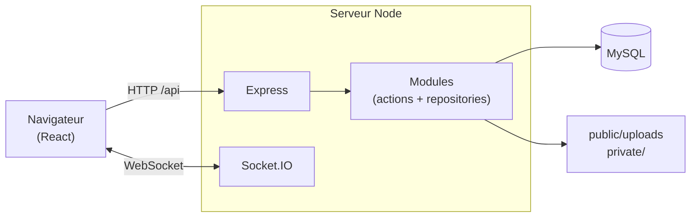

# WeGather

**Organisez vos événements à plusieurs, au même endroit.**

WeGather est une plateforme collaborative pour préparer un événement entre amis, en famille ou entre collègues : un week-end, un mariage, un séminaire… Chaque événement a son propre espace avec une messagerie en direct, un budget partagé, une liste de tâches, une galerie photo et les réservations du groupe.

🌐 [wegather.fr](https://wegather.fr)

---

## Sommaire

- [Fonctionnalités](#fonctionnalités)
- [Stack technique](#stack-technique)
- [Architecture](#architecture)
- [Installation en local](#installation-en-local)
- [Variables d'environnement](#variables-denvironnement)
- [Commandes](#commandes)
- [Structure du projet](#structure-du-projet)
- [Sécurité](#sécurité)
- [Mise en production](#mise-en-production)
- [Contribuer](#contribuer)
- [Licence](#licence)

## Fonctionnalités

**Événements**
- Création d'un événement avec nom, dates, lieu, description et image recadrable.
- Invitation des participants grâce à un code à 6 caractères.
- Quitter un événement ; l'hôte peut le modifier, le supprimer et bannir un participant.

**Espace de l'événement**
- 💬 **Messagerie en direct** (Socket.IO) : réponses, réactions, images, modification et suppression des messages, compteur de messages non lus.
- 💶 **Budget partagé** : dépenses de chacun et total par participant.
- ✅ **Liste de tâches** avec échéances.
- 🖼️ **Galerie photo** : descriptions, « j'aime », téléchargement de toutes les photos en un fichier zip.
- 🧳 **Réservations** (transport, logement, activités…) avec documents joints.

**Compte**
- Inscription, connexion, mot de passe oublié (lien valable 30 minutes), changement de mot de passe.
- Photo de profil.

**Modération et administration**
- Signalement d'un utilisateur, d'un événement ou d'un bug, avec captures d'écran.
- Tableau de bord administrateur : statistiques, traitement des signalements, bannissement d'utilisateurs ou d'événements, gestion des rôles (admin et superadmin).

**Pages publiques** : présentation, contact (transmis sur Discord), CGV, mentions légales, politique de confidentialité.

## Stack technique

| Partie | Technologies |
|---|---|
| Client | React 19, TypeScript, Vite, React Router, Socket.IO client, Framer Motion, Recharts, SweetAlert2 |
| Serveur | Node.js, Express 4, TypeScript (exécuté avec tsx), Socket.IO, mysql2, argon2, JSON Web Token, Multer, Nodemailer |
| Base de données | MySQL 8 |
| Outillage | npm workspaces (monorepo), Biome (lint et formatage), Concurrently |

## Architecture



- Le serveur est découpé en **modules** (`user`, `event`, `message`, `budget`, `todo`, `gallery`, `reservation`, `admin`…). Chaque module a des **actions**, qui gèrent la requête HTTP, et un **repository**, qui contient les requêtes SQL.
- La session est un **JWT** stocké dans un cookie `httpOnly`.
- **Socket.IO** diffuse les nouveaux messages aux membres de l'événement, chacun dans la « room » de son événement.
- **En production**, le serveur Express sert aussi le client compilé (`client/dist`) : tout passe par le même domaine.

## Installation en local

### Prérequis

- Node.js 20 ou plus récent
- MySQL 8
- Une boîte e-mail avec accès SMTP pour l'envoi des e-mails (facultatif en local)

### Étapes

```bash
git clone https://github.com/FARVACQUE-L/WeGather.git
cd WeGather
npm install
```

1. Copiez `server/.env.sample` en `server/.env` et `client/.env.sample` en `client/.env`, puis remplissez-les (voir [Variables d'environnement](#variables-denvironnement)).
2. Créez la base de données :
   ```bash
   npm run db:migrate
   ```
   > ⚠️ Cette commande **supprime puis recrée** la base `wegather` à partir de `server/database/schema.sql`.
3. Lancez le client et le serveur :
   ```bash
   npm run dev
   ```
   - Client : http://localhost:3000
   - API : http://localhost:3310

**Devenir administrateur** : créez un compte depuis le site, puis passez-le administrateur directement en base :

```sql
UPDATE user SET user_is_admin = 1, user_is_superadmin = 1 WHERE user_mail = 'vous@exemple.fr';
```

## Variables d'environnement

### `server/.env`

| Variable | Description | Exemple |
|---|---|---|
| `APP_PORT` | Port du serveur | `3310` |
| `NODE_ENV` | `development` affiche le détail des erreurs 500. Mettre `production` sur le serveur. | `development` |
| `DB_HOST`, `DB_PORT` | Adresse de MySQL | `localhost`, `3306` |
| `DB_USER`, `DB_PASSWORD` | Identifiants MySQL | |
| `DB_NAME` | Nom de la base. Doit valoir `wegather`, le nom utilisé par `schema.sql`. | `wegather` |
| `CLIENT_URL` | Adresse du client, utilisée pour CORS, les liens des e-mails et les cookies `Secure` (en `https`) | `http://localhost:3000` |
| `TOKEN_SECRET` | Secret de signature des JWT : une longue chaîne aléatoire | |
| `EMAIL_HOST`, `EMAIL_PORT` | Serveur SMTP d'envoi des e-mails (facultatif, IONOS par défaut) | `smtp.ionos.fr`, `465` |
| `EMAIL_USER`, `EMAIL_PASS` | Boîte qui envoie les e-mails automatiques (bienvenue, mot de passe, modération) | `nepasrepondre@wegather.fr` |
| `DISCORD_CONTACT_WEBHOOK_URL` | Webhook Discord qui reçoit le formulaire de contact | |

Pour générer un `TOKEN_SECRET` :

```bash
node -e "console.log(require('crypto').randomBytes(48).toString('base64url'))"
```

### `client/.env`

| Variable | Description | Exemple |
|---|---|---|
| `VITE_API_URL` | Adresse de l'API, intégrée au client au moment du build | `http://localhost:3310` |

## Commandes

À lancer depuis la racine du dépôt.

| Commande | Description |
|---|---|
| `npm install` | Installe les dépendances du client et du serveur |
| `npm run dev` | Lance le client (Vite) et le serveur (rechargement automatique) |
| `npm run db:migrate` | Recrée la base depuis le schéma. ⚠️ **Efface toutes les données.** |
| `npm run db:seed` | Remplit la base avec des données de test. ⚠️ Efface les données existantes. |
| `npm run build` | Compile le client dans `client/dist` (ne touche pas à la base) |
| `npm run start` | Démarre le serveur, qui sert aussi le client compilé |
| `npm run check` | Vérifie le code (Biome et TypeScript) sur les fichiers indexés par git |
| `npm run check:fix` | Corrige automatiquement le formatage des fichiers indexés par git |

Avec `NODE_ENV=production`, `db:migrate` et `db:seed` refusent de s'exécuter, sauf avec `ALLOW_DB_RESET=yes`.

## Structure du projet

```plaintext
WeGather/
├── client/                    # Application React (Vite)
│   ├── public/
│   └── src/
│       ├── assets/            # Images et polices
│       ├── components/        # Messagerie, Budget, ToDoList, Galerie, Reservation…
│       ├── pages/             # Présentation, Connexion, HomeEvents, Admin…
│       ├── helper/            # Garde d'authentification, imageUrl…
│       ├── socket/            # Connexion Socket.IO
│       ├── types/
│       └── main.tsx           # Routes
│
├── server/                    # API Express
│   ├── bin/                   # Scripts migrate et seed
│   ├── database/
│   │   ├── schema.sql         # Schéma complet de la base
│   │   ├── client.ts          # Pool de connexions MySQL
│   │   └── fixtures/          # Données de test
│   ├── public/
│   │   ├── assets/            # Images par défaut
│   │   └── uploads/           # Photos envoyées (publiques)
│   ├── private/               # Pièces de signalement et documents de réservation (non publics)
│   └── src/
│       ├── modules/           # Un dossier par domaine : actions, repository, routes
│       ├── middleware/        # Authentification, upload, limites de requêtes, en-têtes de sécurité
│       ├── helper/            # Validation, droits d'accès aux événements, JWT…
│       ├── app.ts             # Configuration d'Express
│       ├── router.ts          # Montage des routes
│       ├── socket.ts          # Serveur Socket.IO
│       └── main.ts            # Point d'entrée
│
└── package.json               # Workspaces et scripts communs
```

## Sécurité

- **Mots de passe** : hachés avec argon2. Les règles (12 caractères minimum, majuscule, minuscule, chiffre, caractère spécial) sont vérifiées par le serveur.
- **Sessions** : JWT dans un cookie `httpOnly`, `Secure` en HTTPS. Un changement de mot de passe déconnecte les autres sessions.
- **Droits d'accès** :
  - chaque route liée à un événement vérifie que l'utilisateur en est membre ;
  - les modifications sont réservées à l'auteur ou à l'hôte.
- **Limites de requêtes** sur la connexion, l'inscription, le mot de passe oublié, les messages et les signalements.
- **Validation** des identifiants, longueurs, dates et montants. Les requêtes SQL sont toutes paramétrées.
- **En-têtes de sécurité** HTTP. Le détail des erreurs internes est masqué en production.

## Mise en production

L'application tourne sur un VPS Ubuntu :
- **Nginx** gère le HTTPS (Let's Encrypt) et transmet toutes les requêtes, WebSocket compris, au serveur Node ;
- **pm2** lance et relance le serveur Node ;
- **MySQL** tourne sur la même machine.

1. **`server/.env`** :
   ```plaintext
   NODE_ENV=production
   CLIENT_URL=https://wegather.fr
   TOKEN_SECRET=<longue chaîne aléatoire>
   ```
2. **`client/.env`** : `VITE_API_URL=https://wegather.fr`
3. **Installation, build et démarrage** :
   ```bash
   npm install
   npm run build
   pm2 start npm --name wegather -- start
   pm2 save
   ```
4. **Création de la base**, à la **première installation uniquement** :
   ```bash
   NODE_ENV=production ALLOW_DB_RESET=yes npm run db:migrate
   ```

**Mise à jour du site** :

```bash
git pull && npm install && npm run build && pm2 restart wegather
```

> ⚠️ Lancez le serveur en **une seule instance** : n'utilisez pas le mode cluster de pm2. Les limites de requêtes et la présence dans le chat sont gardées en mémoire.

> 💾 Sauvegardez régulièrement la base MySQL ainsi que les dossiers `server/public/uploads` et `server/private`, sur une autre machine que le serveur.

**Logs** : `pm2 logs wegather`

## Contribuer

1. Créez une branche depuis `dev`, numérotée : `0055-nom-de-la-fonctionnalite`.
2. Vérifiez le code avant de committer : `npm run check`. Le hook de pré-commit le lance aussi.
3. Écrivez des messages de commit au format [Conventional Commits](https://www.conventionalcommits.org/fr/) : `feat:`, `fix:`, `chore:`…
4. Ouvrez une Pull Request vers `dev`. La CI GitHub lance Biome et TypeScript.

## Licence

Distribué sous licence MIT. Voir [LICENSE.md](LICENSE.md).
